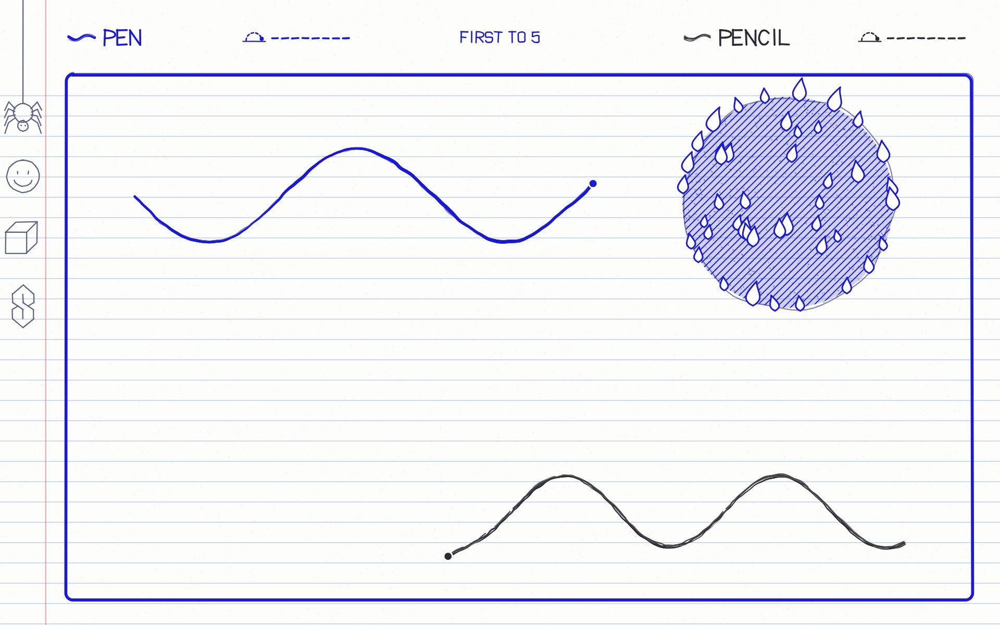
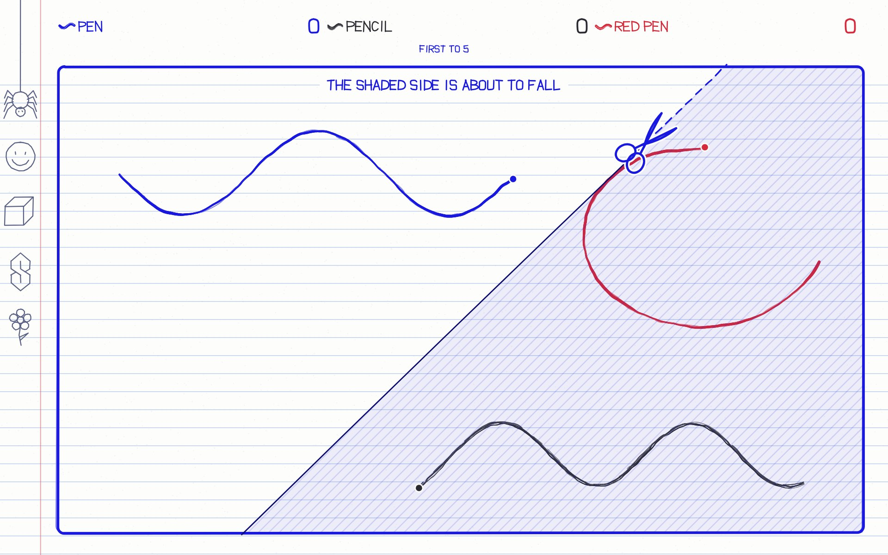
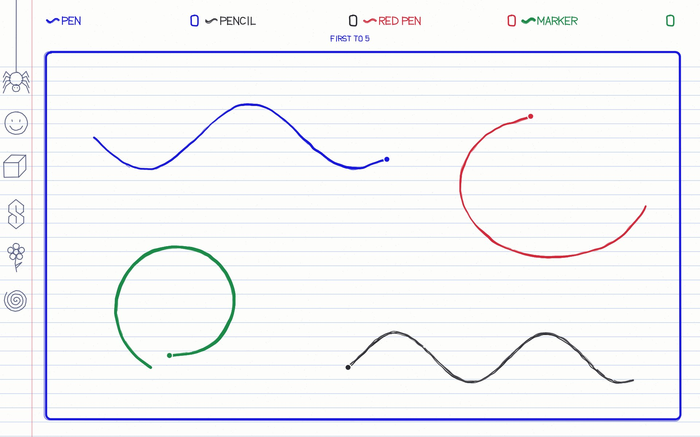
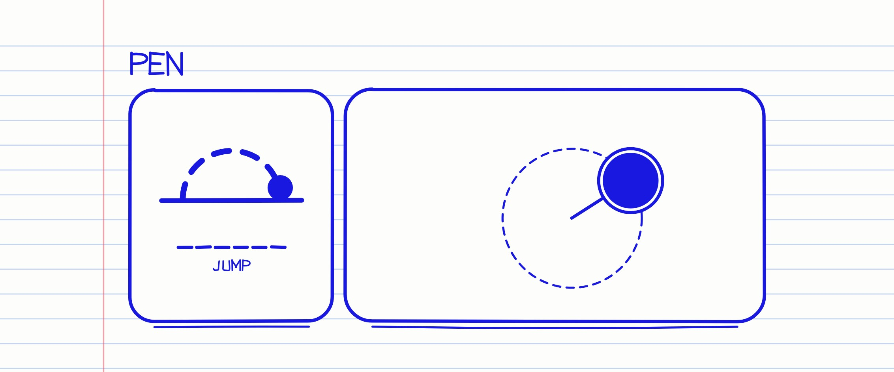
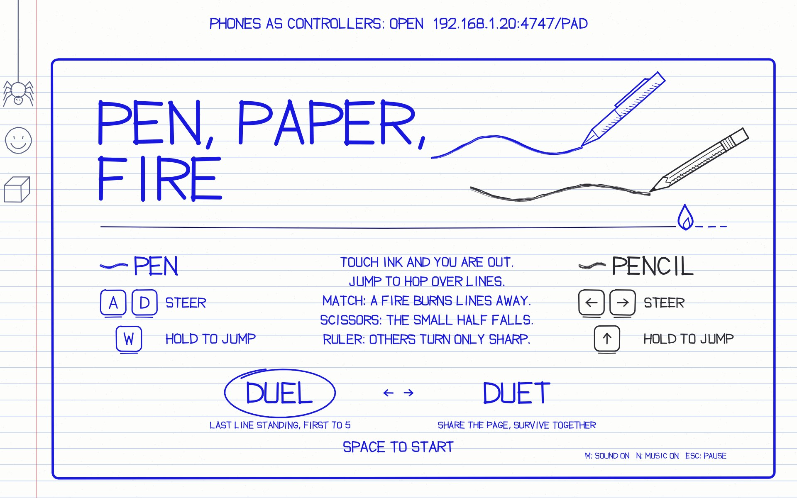

# Pen, Paper, Fire

A local multiplayer line-duel played on a sheet of college-ruled paper, drawn the way you would sketch it in a margin. Everyone steers a drawing line that never stops. Touch any ink and you are out. Last line standing wins.

Put the game on a big screen or TV, and steer from your phones over the local wifi, or share one keyboard.



In the spirit of *Achtung, die Kurve!*, with a notebook for a board.

## How it plays

- **Steer** your line. It moves on its own and leaves ink behind it.
- **Touch ink, or cross the hand-drawn box, and you are out.** The box is the edge of the game.
- **Jump** to hop over lines. You get about 1.4 seconds of air time, and it refills while you draw.
- **Pickups** appear on the page one at a time, taking turns:

| Pickup | What it does |
| --- | --- |
| **Match** | Starts a fire somewhere else on the page. A dashed ring shows how far it will spread. It burns away every line it touches and knocks out anyone inside. Once it dies down, the scorched paper is safe again. |
| **Scissors** | Cuts the whole page in two along the way you were heading. The side that is about to fall is shaded for 1.7 seconds, then the smaller side drops away with anything on it. The box stays smaller for the rest of the round. |
| **Ruler** | Puts everyone else on the ruler for 7 seconds: no curves, only sharp 90 degree turns. |

### Modes

- **Duel**: last line standing takes the round. First to 5 wins the match.
- **Duet**: everyone shares the page and tries to survive together. Your best time is saved in the browser.

Pick the mode on the title screen with the steering keys, or by pushing the stick left or right on a phone.



## Players

Up to **12 players**. Each seat is a different drawing instrument with its own colour and line texture: pen, pencil, red pen, marker, crayon, gel pen, felt tip, charcoal and more.



### Keyboard

The first two seats can play from the keyboard.

| | Pen | Pencil |
| --- | --- | --- |
| Steer | `A` / `D` | `Left` / `Right` |
| Jump (hold) | `W` | `Up` |

`Space` starts and continues, `Esc` pauses, `M` mutes everything, `N` turns the music off.

### Phones as controllers

Every phone that opens the controller page takes the next free seat. This is how you get past two players.

1. Start the server on the computer that is showing the game:
   ```
   node server.js
   ```
   On Windows you can double-click `start.bat` instead. It opens the game at `http://localhost:4747`.
2. Connect the phones to the same wifi as the computer.
3. On each phone, open the address shown at the top of the title screen. It ends in `/pad`.
4. Drag the stick on the right toward where you want your line to go. Hold the button on the left to jump. Between rounds the left button becomes Start and Next.



Notes:

- If Windows asks about the firewall the first time, allow Node.js on private networks. Otherwise phones cannot reach the computer.
- Only one game screen at a time can drive the phones. If you open a second tab, the newest one takes over.
- Sound comes from the computer, not the phones. The browser keeps it silent until you press a key or click on the game once.
- The port is `4747`. Set `PORT` to change it.
- If you run the server inside WSL, phones cannot reach it directly. The server prints the two `netsh` commands that forward the port. Running it with Windows Node avoids this.

You can also open `index.html` straight from disk for keyboard-only play with no server.



## What it is made of

Plain HTML, canvas and JavaScript, with **no dependencies and no build step**. `server.js` uses only Node's built-in modules, including a small hand-written WebSocket relay.

| File | What it does |
| --- | --- |
| `index.html`, `game.js` | The game screen: simulation, paper cutting, fire, pickups, sound and music |
| `sketch.js` | The hand-drawn look, shared with the controller: wobbly lines, stroke lettering, the drawing instruments |
| `pad.html` | The phone controller |
| `server.js` | Serves the game and the controller, and relays phone input over WebSocket |
| `start.bat` | Windows launcher |

Some details that may be of interest:

- Every letter, key cap and doodle is drawn stroke by stroke at runtime. There are no fonts or image files, and the sketchy look redraws a few times a second.
- The paper is a grid. When a cut closes off a region, a flood fill finds the smaller piece, and it falls away as its own sheet.
- All sound is generated with the Web Audio API, from the pen scratch and the fire crackle to the looping tune.

## Status

This is a young project. The speed, jump length and pickup timings are first guesses and will want tuning by playing it.

It has been tried mainly in desktop Chromium, with an Android phone as a controller. It has not been tested on iPhone or Safari.
